  

  <a href="#sobre-mí"><b>Sobre mí</b></a>&nbsp;&nbsp;·&nbsp;&nbsp;
  <a href="#proyectos"><b>Proyectos</b></a>&nbsp;&nbsp;·&nbsp;&nbsp;
  <a href="#stack"><b>Stack</b></a>&nbsp;&nbsp;·&nbsp;&nbsp;
  <a href="#contacto"><b>Contacto</b></a>

## Sobre mí

Soy desarrollador **full stack**. Construyo sistemas completos, del modelo de datos a la interfaz, y me importa que sigan funcionando bien cuando los usa gente real al mismo tiempo, no solo en la demo.

**Lo que he construido:**

- **Un punto de venta** con Spring Boot y React donde el stock nunca queda negativo, aunque dos cajeros vendan la última unidad a la vez, y un doble clic nunca cobra dos veces. Tiene 49 clases de prueba contra PostgreSQL real y se despliega solo cuando el CI pasa.
-  **Un Kanban en tiempo real** con ASP.NET Core, SignalR y Clean Architecture: chat con notas de voz, notificaciones y un outbox transaccional que entrega cada evento una sola vez, aunque corran varias instancias.
- **Un blog** con Laravel y permisos por rol que se validan en el servidor, con inicio de sesión con Google, Microsoft o Facebook.
- **Un sistema de créditos** con Python y Flask: tabla de amortización, control de atrasos y reportes en Excel y PDF, con seguridad lista para producción (CSRF, CSP y bloqueo por intentos), más del 90 % de cobertura de pruebas y pruebas en el navegador con Playwright.

Trabajo con **Java + Spring Boot**, **C# + ASP.NET Core**, **PHP + Laravel** y **Python + Flask** en el backend, y con **React + TypeScript** en el frontend.

## Proyectos

Cada tarjeta muestra cómo está construido el proyecto por dentro.

  <a href="https://github.com/IrvinSegura/Sistema-de-Inventario-y-Facturacion_Back"><b>API · Java + Spring Boot</b></a>&nbsp;&nbsp;|&nbsp;&nbsp;
  <a href="https://github.com/IrvinSegura/Sistema-de-Inventario-y-Facturacion_Front"><b>Web · React + TypeScript</b></a>

<a href="https://github.com/IrvinSegura/TaskBoard"><b>Ver repositorio · ASP.NET Core + React</b></a>

<a href="https://github.com/IrvinSegura/IRSO-BLOG"><b>Ver repositorio · Laravel + Livewire</b></a>

<a href="https://github.com/IrvinSegura/Registros-de-Creditos"><b>Ver repositorio · Python + Flask</b></a>

## Stack

## Contacto

¿Tienes un proyecto, una vacante o una idea? Me encantará escucharte.

📧 **[irvin.segura.14@gmail.com](mailto:irvin.segura.14@gmail.com)**

